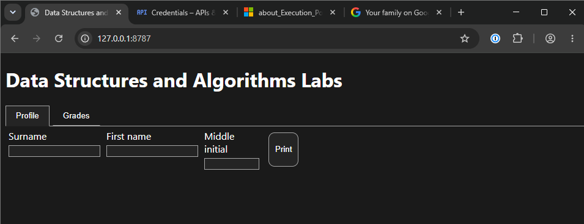

# Coding agent session on 2026-11-09 09:36 with GitHub Copilot

_Note that BYOK mode is enabled using Google Generative Language API for Gemini models rather than using Copilot Fusion as a Copilot Student plan user. This transcript is edited for brevity, especially on trimming off tool calls._

## Andrei Jiroh



Any hints on how to make the button go under the form fields?

## GitHub Copilot (Gemini 3.8 Flash)

Here are two common ways to achieve this depending on how you want the fields arranged:

### Option 1: Keep inputs in a row, button below (Recommended)

Wrap the input fields in a container `div`, and set `#profileForm` to `flex-direction: column`:

1. **In `index.html`**:
   ```html
   <form id="profileForm">
     <div class="fields-row">
       <div id="surnameField">...</div>
       <div id="firstNameField">...</div>
       <div id="middleInitialField">...</div>
     </div>
     <button id="submit" type="submit" value="Print">Print</button>
   </form>
   ```

2. **In `style.css`**:
   ```css
   #profileForm {
     display: flex;
     flex-direction: column;
     align-items: flex-start;
     gap: 10px;
     width: fit-content;
   }

   .fields-row {
     display: flex;
     gap: 5px;
   }
   ```

---

### Option 2: CSS-only (Flex wrap)

Enable wrapping on the form and force the button onto its own line:

```css
#profileForm {
  display: flex;
  flex-wrap: wrap;
  width: fit-content;
}

#profileForm #submit {
  flex-basis: 100%;
  width: fit-content; /* keeps the button from stretching full width */
}
```

*(Note: Also remove or adjust `width: 150px;` on `#profileForm` in `style.css`, as it restricts the form's overall width.)*

User: While we're onto it, I am working on a client-side PDF generation of grade report via `pdf-lib` JavaScript package per https://medium.com/joyfill/how-to-generate-pdfs-in-the-browser-with-javascript-no-server-needed-1476aa43df13 but I want to use separate font for the heading 1 text and the body text. Per the official API docs at https://pdf-lib.js.org/docs/api/, what should I use?

GitHub Copilot: Per the `pdf-lib` API docs, your font embedding approach is already on the right track! 

To use separate fonts for heading and body text, you pass the embedded font instance to the `font` option of `page.drawText(...)`.

### 1. Embed the fonts
Using standard fonts:
```javascript
const headingFont = await pdfDoc.embedFont(StandardFonts.HelveticaBold);
const bodyFont = await pdfDoc.embedFont(StandardFonts.Helvetica);
```
*(You can also use `StandardFonts.TimesRomanBold` / `StandardFonts.TimesRoman`, `StandardFonts.CourierBold` / `Courier`, or custom `.ttf`/`.otf` files via `await pdfDoc.embedFont(fontBytes)` using `fontkit` if you ever want custom web fonts).*

### 2. Draw using the respective `font` option

When drawing to the page via `page.drawText(text, options)`, specify the font you want:

```javascript
async function printToPdf(sortedResult) {
  const pdfDoc = await PDFDocument.create();
  const page = pdfDoc.addPage(PageSizes.Letter);
  const { width, height } = page.getSize();

  // 1. Embed separate fonts
  const headingFont = await pdfDoc.embedFont(StandardFonts.HelveticaBold);
  const bodyFont = await pdfDoc.embedFont(StandardFonts.Helvetica);

  // 2. Draw Heading 1 using headingFont
  let currentY = height - 50;
  page.drawText('Grade Report', {
    x: 50,
    y: currentY,
    size: 20,
    font: headingFont,
    color: rgb(0, 0, 0),
  });

  currentY -= 30;

  // 3. Draw Body text using bodyFont
  sortedResult.forEach((item) => {
    page.drawText(`${item.subject}: ${item.grade}`, {
      x: 50,
      y: currentY,
      size: 12,
      font: bodyFont,
      color: rgb(0.2, 0.2, 0.2),
    });
    currentY -= 18;
  });

  const pdfBytesResult = await pdfDoc.save();
  const pdfFileBlob = new Blob([pdfBytesResult], { type: 'application/pdf' });

  // Open in new tab or trigger download
  const url = URL.createObjectURL(pdfFileBlob);
  window.open(url);
}
```

### Noticeable bugs to watch out for in your snippet:
1. **Blob variable name mismatch**: In `new Blob([pdfBytes], ...)`, you defined `const pdfBytesResult = await pdfDoc.save();`, so it should be `[pdfBytesResult]`.
2. **Strict equality in handler**: `if (clickedButton.id = "print")` uses assignment (`=`) instead of strict comparison (`===`). Also check the button ID in `index.html` (it is `printToPdf`, not `print`).

## Andrei Jiroh

Done those bug fixes but I want to do presets of subject name by year-semester combination dropdown menu and another one for quarters (prelims, midterms, prefinals, finals, final grade) rather than painfully inputting them (the default if unselected).

## GitHub Copilot (Gemini 3.8 Flash)

I have implemented the preset dropdown menus for both **Year & Semester** and **Quarters/Periods**.

### Changes Made:

1. **Preset Controls in `index.html`**:
   - Added a **Year & Semester Preset** `<select>` with options from 1st Year to 4th Year (1st and 2nd semesters), defaulting to **Custom (Manual)**.
   - Added a **Quarter / Period Preset** `<select>` with options for **All Quarters (Prelims, Midterms, Prefinals, Finals, Final Grade)** as well as individual periods (*Prelims*, *Midterms*, *Prefinals*, *Finals*, *Final Grade*), defaulting to **Custom (Manual)**.

2. **Preset Handling in `gradesFormHandler.mjs`**:
   - Defined STI IT/CS curricula subject mappings for each year/semester combination (`y1s1` through `y4s2`).
   - Defined quarter list: `Prelims`, `Midterms`, `Prefinals`, `Finals`, `Final Grade`.
   - **All Quarters preset**: Automatically populates the first 5 rows with the grading periods and clears remaining rows.
   - **Year & Semester preset**: Populates the subject name input fields with the curriculum courses for that semester.
   - **Combination**: Selecting a specific quarter along with a semester appends the period (e.g., `Data Structures and Algorithms (Prelims)`).
   - **Custom (Manual)**: Left as default, leaving subject inputs freely editable.
   - **PDF Header**: The generated PDF title automatically reflects the selected year-semester and quarter combination.

3. **Styling in `style.css`**:
   - Styled `.presetControls`, `.presetField`, and `select` to match the existing dark/light mode palette.

## Andrei Jiroh

Maybe we don't need to mention the quarter inside the parthesis after the subject name but only shown them in the PDF export. How about using tables to make it a bit neat in the PDF export itself?

## GitHub Copilot (Gemini 3.8 Flash)

I've updated `gradesFormHandler.mjs` with both improvements:

### 1. Cleaner Subject Names in the Form
- The quarter suffix (e.g. `(Prelims)`) is no longer appended into the input text boxes. The subject names remain clean (e.g. *Data Structures and Algorithms*).
- When a quarter is chosen, that quarter information is transferred to the PDF header/table rather than cluttering the input fields.

### 2. Neat Table Layout in the PDF Export
- **Title & Subtitle**: Shows the report title alongside a subtitle featuring the selected Year & Semester and/or Quarter (e.g., `2nd Year - 1st Semester — Prelims`).
- **Table Structure**:
  - Uses `page.drawRectangle(...)` to render an authentic table with alternating row colors (striped styling) and clean borders.
  - **Header Row**: Highlighted background displaying `"Subject / Course"` (or `"Quarter / Period"` when all quarters are chosen) and a dynamic grade column header like `"<Quarter> Grade"` (e.g., `"Prelims Grade"` or `"Grade"`).
  - **Data Rows**: Left-aligned subject names and bold grade values aligned cleanly in their respective columns.

## Andrei Jiroh

Since we implemented that, how about bringing that table setup into the HTML itself to match the experience?

## GitHub Copilot (Gemini 3.8 Flash)

I have updated the on-page HTML report in `gradesFormHandler.mjs` and styled it in `style.css` to match the PDF export layout:

### What was updated:
1. **Dynamic HTML Table Generation (`gradesFormHandler.mjs`)**:
   - Instead of plain paragraphs (`Subject: Grade`), clicking **Report** now constructs an HTML table inside `#sortedResult`.
   - Displays **Grade Report** with the active subtitle (e.g., `2nd Year - 1st Semester — Prelims`).
   - Table columns mirror the PDF layout: dynamic subject header (`Subject / Course` or `Quarter / Period`) and grade header (`<Quarter> Grade` or `Grade`).
   - HTML-escapes inputs via `escapeHtml()` to ensure safe rendering.

2. **Styling Matching the PDF (`style.css`)**:
   - Created `.reportTableContainer`, `.reportTable`, `.reportTitle`, and `.reportSubtitle`.
   - Includes subtle bordered cards, shaded `<thead>` header, right-aligned bold grade values (`.gradeCol`), and alternating zebra striping (`tbody tr:nth-child(even)`), matching both light and dark modes.
